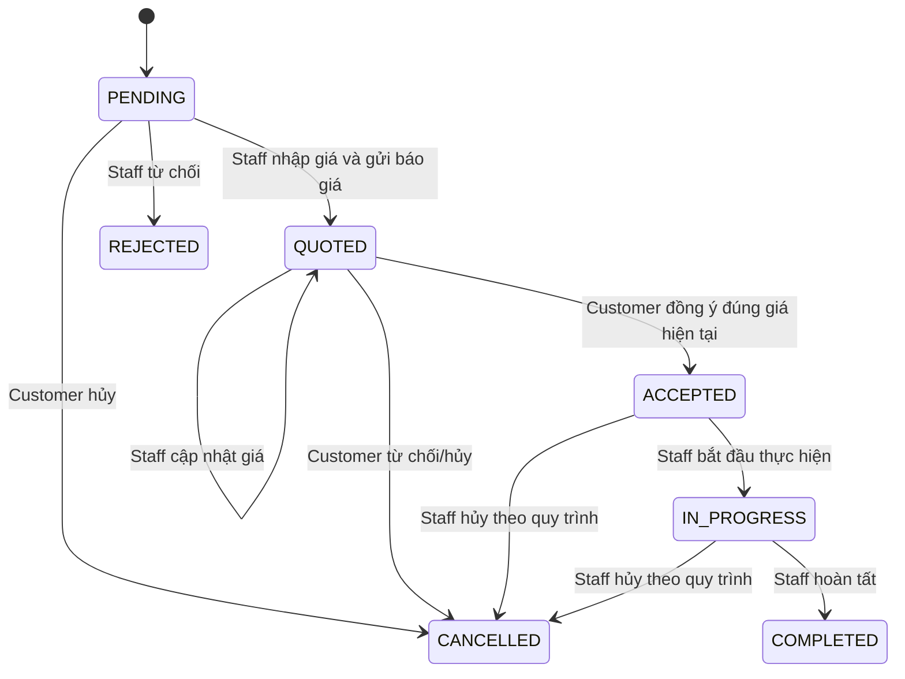

# Hợp đồng API Custom

Phạm vi: Customer tạo và theo dõi yêu cầu; Staff báo giá và xử lý tiến độ. API dùng Session cookie. Các phản hồi lỗi dùng cấu trúc chung `status/error/message/timestamp`.

## Endpoint

| Method, path | Vai trò | Thành công |
|---|---|---|
| `POST /api/custom-requests` | Customer | `201`, tạo yêu cầu `PENDING` |
| `GET /api/custom-requests/my?page=0&size=10` | Customer | `200`, danh sách của chính khách |
| `GET /api/custom-requests/my/{id}` | Customer sở hữu | `200`, chi tiết và lịch sử mới nhất trước |
| `PUT /api/custom-requests/my/{id}/accept` | Customer sở hữu | `200`, chấp nhận báo giá hiện tại |
| `PUT /api/custom-requests/my/{id}/decline` | Customer sở hữu | `200`, hủy/từ chối khi còn `PENDING` hoặc `QUOTED` |
| `GET /api/staff/custom-requests?status=...` | Staff/Admin | `200`, danh sách xử lý |
| `GET /api/staff/custom-requests/{id}` | Staff/Admin | `200`, chi tiết và lịch sử |
| `PUT /api/staff/custom-requests/{id}/quote` | Staff/Admin | `200`, lưu giá và ghi sự kiện báo giá |
| `PUT /api/staff/custom-requests/{id}/status` | Staff/Admin | `200`, chuyển trạng thái hợp lệ |

Tạo yêu cầu nhận các trường `layout`, `switchType`, `switchName`; có thể gửi thêm `caseMaterial`, `keycapSet`, `ledType`, `lubeSwitch`, `hotSwap`, `budget`, `note`. Giá báo nhận `{ "quotedPrice": 1300000, "quoteNote": "..." }`. Customer đồng ý phải gửi lại giá đã thấy: `{ "quotedPrice": 1300000 }`; Staff chuyển tiến độ bằng `{ "status": "IN_PROGRESS", "note": "..." }`.

## Trạng thái

Mỗi lần đổi trạng thái ghi `oldStatus`, `newStatus`, vai trò người thực hiện, ghi chú và thời gian vào lịch sử. Các bản ghi lịch sử được trả theo thứ tự mới nhất trước.

## Mã lỗi và quyền sở hữu

| Tình huống | HTTP / error |
|---|---|
| Guest gọi endpoint yêu cầu đăng nhập | `401 UNAUTHORIZED` |
| Vai trò không được phép | `403 FORBIDDEN` |
| Customer đọc, chấp nhận hoặc từ chối yêu cầu không thuộc mình; ID không tồn tại | `404 NOT_FOUND` |
| Giá Customer gửi khác báo giá hiện tại | `409 QUOTE_CHANGED` |
| Chuyển trạng thái không hợp lệ | `409 INVALID_TRANSITION` |
| Chuyển sang `QUOTED` khi chưa có giá | `409 QUOTE_REQUIRED` |
| Dữ liệu đầu vào sai | `400 VALIDATION_ERROR` |

Trả `404` cho yêu cầu của khách khác để không tiết lộ yêu cầu đó có tồn tại hay không. Quy tắc này thống nhất với truy vấn sở hữu và kiểm thử `PostUiApiIntegrationTests`.
